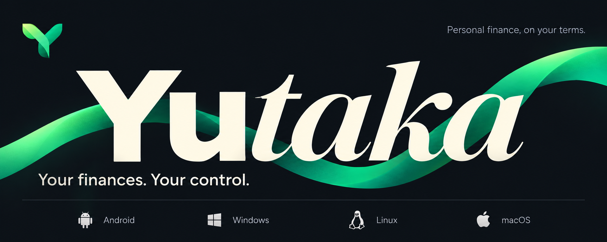

<div align="center">



**Your finances. Your control.**

A local-first personal finance app for **Android, Windows, Linux, and macOS**.<br>
Track spending, accounts, loans, plans, and subscriptions. Use it offline or connect your own sync server.

<p>
  <a href="https://github.com/Chowdhury-Siam/Yutaka/releases/latest"></a>
  <a href="https://github.com/Chowdhury-Siam/Yutaka"></a>
  <a href="LICENSE"></a>
  <br>
  <a href="https://flutter.dev"></a>
  <a href="https://dart.dev"></a>
  
</p>

[**Download Latest**](https://github.com/Chowdhury-Siam/Yutaka/releases/latest) · [**Setup Guide**](docs/GUIDE.md) · [**Report a Bug**](https://github.com/Chowdhury-Siam/Yutaka/issues) · [**Privacy Policy**](PRIVACY_POLICY.md)

</div>

> [!TIP]
> **No account is needed for offline use.** Choose **Use offline**, then **Start New** or **Restore**. Self-hosted sync is optional.

---

## 🧭 Explore

- [Meet Yutaka](#meet-yutaka)
- [Features](#features)
- [Get started](#get-started)
- [Accounts, transactions, and loans](#accounts-transactions-and-loans)
- [Plans, subscriptions, and notes](#plans-subscriptions-and-notes)
- [Self-hosted sync](#self-hosted-sync)
- [Backups and reports](#backups-and-reports)
- [Settings](#settings)
- [Development](#development)
- [Publishing](#publishing)
- [Troubleshooting](#troubleshooting)
- [Developers](#developers)
- [License](#license)

---

<a id="meet-yutaka"></a>

## ✨ Meet Yutaka

Yutaka brings your everyday finances into one place. Record income and expenses, move money between accounts, follow your budgets, and keep track of what you owe or are waiting to receive.

Your records are saved to a local SQLite database first. Use the app without a server, then connect your own Cloudflare Worker and Turso database when you want to synchronize across devices.

Start with your current account balances, add existing loans without changing those balances, and build your history from there.

---

<a id="features"></a>

## 💎 Your Money, in One Place

### 💳 Accounts & Transactions

Track multiple accounts, income, expenses, and transfers. Add titles, notes, optional service charges, and date or time ranges; search and sort your history.

### 📊 Budgets & Analysis

Set monthly budgets and follow spending, income, cash flow, and net results with charts and category breakdowns.

### 🤝 Lending & Borrowing

Record existing debt or new loans, repayments, additional lending, interest, and due dates with a dated timeline.

### 🗓️ Plans & Subscriptions

Plan purchases with reminders, turn a purchase into an expense, and record recurring subscriptions automatically or with Add now.

### 📝 Notes That Stay with You

Keep formatted notes with automatic saving and bookmarks. Notes participate in backups and optional multi-device sync.

### 📄 Reports in Your Format

Export date-filtered summaries or transaction history as PDF, XLSX, or TXT. Send reports to Telegram or Google Drive through your Worker.

### 💾 Backup & Restore

Create portable backup files, schedule local backups, and merge restored records with your current data. Equivalent categories are reconciled.

### ☁️ Sync on Your Own Server

Connect your own Worker for realtime foreground sync, account administration, and optional scheduled cloud delivery.

### Everyday details

- Material 3 layouts, Inter typography, green accents, and light, dark, or system themes.
- Desktop text selection and copying, keyboard focus controls, and Enter to submit login or registration.
- Quick account and category creation from transaction pickers.
- Profile photos, GIFs, and short videos with crop framing and repositioning.
- Android reminders and background jobs.
- In-app update progress for direct distributions; Google Play and Flatpak use their distribution's update system.

---

<a id="get-started"></a>

## 🚀 Get Started

### Download and install

Choose the matching attachment from [the latest GitHub release](https://github.com/Chowdhury-Siam/Yutaka/releases/latest).

| Platform | Package | Installation |
| --- | --- | --- |
| **Android** | ARM64, ARM32, or universal APK | Choose ARM64 for a compatible modern device, ARM32 for a 32-bit device, or universal when unsure. Open the APK to install. |
| **Windows** | `Yutaka-v<version>-Setup.exe` | Run setup, choose an installation folder, and select an optional desktop shortcut. |
| **Linux** | x64 or ARM64 `Setup.run` | Run `bash <downloaded-file>.run` and follow the graphical installer. GTK 3 is required. |
| **macOS** | `Yutaka-v<version>-macos-universal.pkg` | Open the universal macOS package for Apple Silicon and Intel, then follow setup. |

Linux also supports AppImage distribution and a [standalone Flatpak build](tools/flatpak/README.md). See the [build guide](docs/GUIDE.md#build-from-source) and [installer documentation](tools/installers/README.md) for details.

### First launch

1. Open Yutaka and select **Use offline**.
2. Choose **Start New**, or **Restore** to merge an existing backup.
3. Choose your currency and enter your accounts' **current balances**.
4. Add the amount still owed for any **existing loans**, or skip that step.
5. Finish setup and start recording your finances.

New sync accounts keep setup available after login. Returning accounts with completed setup restore their data and continue into the app.

Legacy `.koinlybackup` files are accepted for migration. Before removing a pre-rebrand Android installation, export its backup: Yutaka's application ID is `com.yutaka.siam`, so Android treats it as a separate app.

---

<a id="accounts-transactions-and-loans"></a>

## 💸 Accounts, Transactions, and Loans

Record an **Expense**, **Income**, or **Transfer**, then choose the account and category. **Time • Date** supports a single timestamp or an optional range. **Service charge** supports a fixed amount or percentage and is off by default.

Search your history or filter by date, account, category, and type. Sorting choices persist. If a date filter hides all records, **Show all** resets the view without deleting anything.

| Loan choice | Use it when | Account balance |
| --- | --- | --- |
| **Existing loan** | Money was lent or borrowed before you entered today's balances | Stays unchanged |
| **New money** | You are lending or receiving money now | Changes when account recording is enabled |

For an existing loan, enter the amount **still owed today**. Future repayments and additions can be recorded against an account. The loan timeline retains dated activity, and interest follows the selected start date and configuration.

---

<a id="plans-subscriptions-and-notes"></a>

## 🗓️ Plans, Subscriptions, and Notes

**Plan** holds purchases you are considering. Add an item, expected price, category, and optional reminder. When you buy it, choose the spending account and Yutaka records an expense at the purchase time.

**Subscription** holds recurring costs with an account, category, price, and schedule. Use automatic recording or **Add now** for a manual occurrence.

**Notes** save as you type. Format your text and bookmark notes you want to keep at the top; the list shows titles for a compact view.

---

<a id="self-hosted-sync"></a>

## ☁️ Self-Hosted Sync

Sync uses **your Cloudflare Worker and Turso database**. Yutaka does not provide a default shared sync service.

When you first open **Deploy Database**, a centered popup offers **Read README**, **Watch YouTube**, or **Skip**. Existing deployments are recognized through saved credentials, validated Workers, saved Worker profiles, or a completed deployment on this device. Skip closes the popup for that visit; it does not mark a deployment as completed.

1. Open **Settings → Account & sync → Deploy Database**, or deploy from your fork using GitHub Actions.
2. Follow the [deployment guide](docs/GUIDE.md#deploy-your-self-hosted-worker) to prepare your Cloudflare token, Account ID, database URL, database token, Worker name, and JWT secret.
3. Validate the Worker URL in Yutaka and create the first account.
4. On another device, use the same Worker URL, username, and password.

The first account becomes administrator. Create additional accounts and manage usernames or passwords at your Worker's `/profile` page. Account deletion is available in-app and at `/delete-account`.

**Upload local changes**, **Restore cloud copy**, and backup imports merge records. Switching to another saved account replaces the active local account data with that account's cloud copy.

See the [full guide](docs/GUIDE.md#connect-yutaka-to-your-worker) for deployment recovery, automatic Worker updates, and account management, or the [Worker documentation](cloud/worker/README.md) for API details.

---

<a id="backups-and-reports"></a>

## 💾 Backups and Reports

| Task | Where to go |
| --- | --- |
| Create or restore a `.yutakabackup` | **Settings → Archive → Local** |
| Schedule a device-folder backup | **Archive → Local backup file → Local** |
| Send backup files to Telegram or Google Drive | **Archive → Local backup file → Cloud** |
| Export a summary or transaction history | **Settings → Analytics** |
| Schedule PDF, XLSX, or TXT delivery | **Archive → Analytics backup → Cloud** |
| Configure Telegram or Google Drive credentials | **Settings → Credential** |

Cloud delivery requires your Worker and uses the latest synchronized cloud data. Enabled automatic cloud uploads must be at least **five minutes apart**.

Android local scheduling uses the system folder picker and retained folder access. Exported files can contain financial records; store them privately.

See [backup and credential setup](docs/GUIDE.md#optional-telegram-cloud-backup) and [data safety](docs/GUIDE.md#data-safety-and-security) for details.

---

<a id="settings"></a>

## ⚙️ Settings at a Glance

| Setting | Purpose |
| --- | --- |
| **Startup page** | Choose Home, Analysis, Loans, Transaction, or Categories; Home is the default |
| **Appearance** | Choose theme and visual preferences |
| **Account & sync** | Validate, deploy, and connect your Worker; manage saved accounts |
| **Credential** | Configure Telegram and Google Drive integrations |
| **Archive** | Create, restore, schedule, and deliver backups |
| **Analytics** | Select report dates, summary/history, and output format |
| **Privacy & data** | Read the policy, manage optional telemetry, and delete a sync account |
| **Advanced settings → Data health** | Inspect privacy-safe diagnostics |

Firebase Analytics and Crashlytics are off by default. You can opt in per device.

---

<a id="development"></a>

## 🛠️ Development

The app uses **Flutter and Dart**, **SQLite** for local data, and an optional **TypeScript Cloudflare Worker** for synchronization.

Use the Flutter SDK pinned by the workflows, with Dart `>=3.12.0 <4.0.0`. Android builds target **Android 16 / API 36** and need the Android SDK and Java 17. Desktop builds need their platform toolchains; the [build guide](docs/GUIDE.md#build-from-source) lists them.

```bash
git clone https://github.com/Chowdhury-Siam/Yutaka.git
cd Yutaka
flutter pub get

# Run the direct Android distribution
flutter run --flavor direct --dart-define=YUTAKA_ANDROID_DISTRIBUTION=direct

# Run the release checks
flutter analyze --no-pub
flutter test --no-pub --reporter expanded
```

A Worker is not required for offline app development. To work on it separately:

```bash
cd cloud/worker
npm ci
npm run typecheck
npm test
```

See the [Worker guide](cloud/worker/README.md) for database setup.

---

<a id="publishing"></a>

## 📦 Publishing

### Deployment walkthrough video

Add a GitHub Actions **repository variable** named `YUTAKA_DEPLOYMENT_VIDEO_URL` under **Settings → Secrets and variables → Actions → Variables**. Set it to your HTTPS YouTube video URL, then run the platform builds. Android (direct and Play), Windows, Linux (including its Flatpak payload), and macOS embed the value in the app.

If the variable is empty or is not an HTTPS YouTube URL, **Watch YouTube** is disabled with an availability message. README and Skip remain available. Changing the variable takes effect in newly built apps.

For a local build, pass `--dart-define=YUTAKA_DEPLOYMENT_VIDEO_URL=https://youtu.be/YOUR_VIDEO_ID` alongside your normal build flags.

GitHub Actions builds Android, Windows, Linux, and macOS packages. The canonical repository's **Publish Stable Release** workflow gathers successful platform builds for the same commit before publishing the stable release.

Android has separate **direct** and **play** flavors. Direct builds use the APK updater; Play builds use Play-managed updates. Linux Flatpak updates are managed by Flatpak.

- [Platform builds and release configuration](docs/GUIDE.md#build-from-source)
- [Desktop installers](tools/installers/README.md)
- [Flatpak packaging](tools/flatpak/README.md)
- [Play data safety checklist](docs/PLAY_DATA_SAFETY.md)
- [Self-hosted Worker deployment](docs/GUIDE.md#deploy-your-self-hosted-worker)

---

<a id="troubleshooting"></a>

## 🩺 Troubleshooting

| Problem | First check |
| --- | --- |
| Transactions appear missing | Clear active date/account/category filters with **Show all** |
| Worker validation fails | Open `https://<your-worker>/health` and check database/schema readiness |
| Another account cannot register | Use the administrator's `/profile` page to create additional accounts |
| Notes are missing on another device | Use the same Worker and username, update both devices, and upload from the source device |
| Telegram or Drive delivery fails | Check **Credential**, destination access, and your latest Worker deployment |
| Android scheduled backup fails | Choose the destination again with the system folder picker and save the schedule |

See the [troubleshooting guide](docs/GUIDE.md#troubleshooting) for deployment errors, database URL examples, and backup recovery steps.

When [reporting a bug](https://github.com/Chowdhury-Siam/Yutaka/issues), include the platform, app version, steps, and expected result. Remove credentials and private financial details from attachments.

---

<a id="developers"></a>

## 👩‍💻 Developers

### Project map

| Path | Responsibility |
| --- | --- |
| `lib/` | Flutter UI, controller, local storage, and synchronization |
| `lib/loans/` | Loan models, interest calculations, and repayment logic |
| `lib/analytics/` | Report generation and Analytics UI |
| `android/` | Android runner, notifications, and background integration |
| `cloud/worker/` | Self-hosted Worker, database schema, and administration |
| `test/` | Flutter, database, widget, and source-contract regressions |
| `tools/installers/` | Windows, Linux, and macOS installer tooling |
| `.github/workflows/` | Build, release, and deployment automation |
| `docs/` | Detailed guide, privacy pages, store checklist, and images |

For changes, describe the affected flow and include relevant verification. Keep app and Worker versions in sync when changing release code, and preserve existing user data across upgrades.

---

<a id="license"></a>

## 📜 License

Yutaka is licensed under **GNU GPL v3.0**. See [LICENSE](LICENSE).

<p align="center"><sub>Your finances. Your control.</sub></p>

